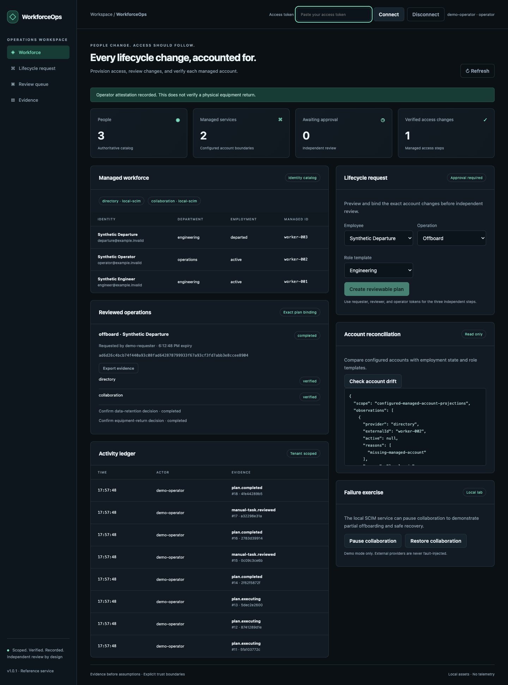
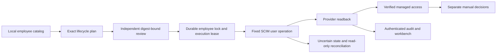

# WorkforceOps

**Identity lifecycle changes with independent approval and verified downstream state.**

Provision, change roles, and offboard synthetic workforce identities through bounded SCIM operations. Inspect account drift, recover from partial outages, retain uncertain-operation locks, and record manual retention and equipment decisions separately from verified account state.

[](https://github.com/jayekwere/workforceops/actions/workflows/verify.yml) [MIT](LICENSE)



## Run it

```sh
git clone https://github.com/jayekwere/workforceops.git
cd workforceops
npm ci --ignore-scripts
npm run build
npm run demo
DEMO=1 npm start
```

Open **http://127.0.0.1:4410**. Startup prints signed fifteen-minute tokens. Connect the requester token, select Synthetic Departure, and create an offboarding plan. Connect the reviewer token to approve its exact digest. Connect the operator token, pause collaboration, and execute. Directory changes are verified while collaboration remains blocked. Restore collaboration and retry the known blocked step. The completed step is not dispatched again. Record manual decisions explicitly and export the evidence.

`docker compose up --build` runs the same scenario with a private local SCIM service inside the container. `docker compose logs` reveals disposable demo tokens. Stop with `docker compose down`. All demo identities and data are synthetic. No external account or credential is required.

## What works

| Workflow           | Enforced behavior                                                                                                                    |
| ------------------ | ------------------------------------------------------------------------------------------------------------------------------------ |
| Onboarding         | Create missing managed users, apply the reviewed role template, verify identity and actual returned state                            |
| Role movement      | Replace allowed SCIM user roles and update the local employee catalog after successful readback                                      |
| Offboarding        | Set managed account `active=false`, clear its SCIM roles, verify each provider, retain manual review tasks                           |
| Drift              | Detect departed users still active, active users inactive, missing managed accounts, orphaned managed accounts and entitlement drift |
| Partial failure    | Persist each step, retry only a known pre-dispatch block, and preserve already verified outcomes                                     |
| Uncertain dispatch | Keep the employee locked, issue no automatic write retry, then reconcile by reading provider state                                   |
| Separation         | Different requester, reviewer and operator subjects, exact approval digest, expiry, version and policy checks                        |
| Evidence           | Durable step states, before/after fingerprints, authenticated audit chain and JSON plan export                                       |

Two independently addressed local SCIM namespaces, directory and collaboration, support real HTTP list/filter/create/PATCH requests with conditional ETags. This is a working local integration, not a mocked browser response. The adapter also supports an explicitly configured HTTPS SCIM endpoint with a dedicated credential. That external path has contract and transport tests; no external SaaS tenant was used for acceptance.

SCIM user `roles` is the entitlement projection supported here. Group membership, provider-specific license APIs, data ownership transfers, session/token revocation, HR ingestion and application-specific provisioning semantics are not implemented. `active=false` does not establish that every cached session or downstream credential is revoked. Manual decisions are operator attestations, not proof of physical equipment return or data transfer. No Okta, Workspace, chat or meeting-platform acceptance is implied.

## Asserted demonstration

`npm run demo` exercises HTTP authentication, an unapproved execution denial, a denied review, partial failure, resumed execution, readback, repeat suppression, onboarding and role movement. It asserts the results before printing them. [Actual sample output](evidence/demo.json) includes:

```text
unapprovedStatus: 409
selfReviewStatus: 403
partialStatus: blocked
resumedStatus: completed
verifiedProviders: directory, collaboration
offboardWritesPerProvider: 1
manualTasksRemain: 2
onboarding: verified
roleChange: verified
auditIntegrity: true
```

The two manual decisions are intentionally open in this CLI sample. The browser test additionally records them as synthetic operator attestations. Evidence hashes, IDs and timestamps change per run.

## Architecture



Plans expire after fifteen minutes. Provider identity, raw before-state, employee record and policy fingerprints are rechecked. SCIM writes use the reviewed resource version. A changed account blocks execution. Network timeouts or failed readback become uncertain. Independent reconciliation fences stale workers and never resends a dirty step. Failed known pre-dispatch operations can be cancelled before a fresh plan is reviewed. See [architecture and recovery semantics](docs/ARCHITECTURE.md).

## Validate and configure

```sh
npm run verify
npm run coverage
npx playwright install chromium
npm run test:browser
docker build -t workforceops:local .
node scripts/container-smoke.mjs workforceops:local
```

[Validation evidence](evidence/VALIDATION.md) records actual outcomes. Tests cover lifecycle operations over local HTTP, conditional update conflicts, partial failure, lost acknowledgements, concurrent retries, stale worker fencing, expired approvals, manual decisions, token constraints, tenant isolation, durable replay and audit tampering. Browser tests exercise all three independent roles and the partial-offboarding recovery. Containers repeat the actual SCIM path under Node 24.

Configured mode requires the common authentication settings plus `PROVIDER_CONFIG` and `EMPLOYEE_CATALOG` JSON paths. Provider credentials come from explicitly named environment variables. `fixtures/providers.example.json` and `fixtures/employees.json` show the shapes. The employee catalog seeds new local records only; successful lifecycle operations maintain existing local records. It is not a live HR synchronization service. Use reviewed migration procedures for catalog identity changes.

Read [API contracts](docs/API.md), [operations](docs/OPERATIONS.md), [threat model](docs/THREAT-MODEL.md), [integration scope](docs/INTEGRATIONS.md), and [design decisions](docs/DESIGN-DECISIONS.md).

## Limits

Single process and local SQLite. At most 100 retained plans and 1,000 execution-key records per tenant. A hard audit bound requires controlled archive/rotation. Credential verification uses a local public JWKS snapshot; external issuance, TLS and key rotation are operator responsibilities. External SCIM behavior, scope restrictions, role semantics and eventual consistency need dedicated live acceptance. Upstream administrators can race state changes. ETags and readback narrow races but do not establish a distributed transaction or exactly-once external effects. Outstanding uncertain operations remain locked until readback proves the reviewed state; no force-unlock or destructive retry endpoint is supplied.

[Security reporting](SECURITY.md) · [Contributing](CONTRIBUTING.md) · [MIT license](LICENSE)

Security review and remediation details are in [the review record](docs/SECURITY-REVIEW.md). Audit history is bounded at 10,000 entries per tenant and 100,000 globally; see the operations guide before any long-running deployment.
